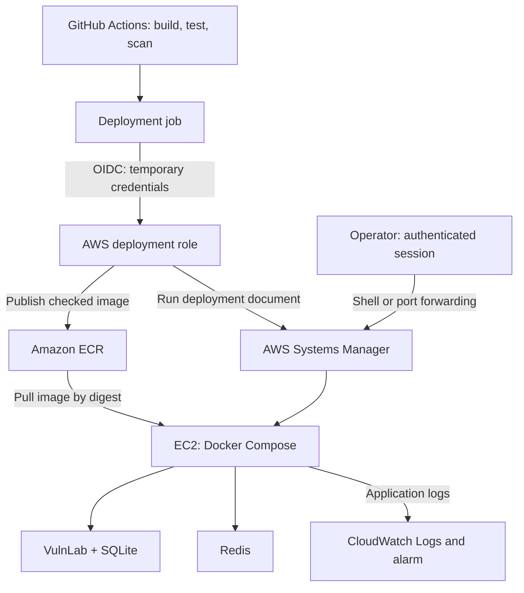

# VulnLab-Cloud

An AWS cloud security and DevSecOps lab that covers infrastructure, controlled application deployment, security monitoring, and recovery.

This project extends [VulnLab](https://github.com/setzexe/VulnLab) (my application security project) into an operational cloud environment. It showcases how to deploy the remediated application with restricted access, look at changes, detect security events, and recover from failed releases or host replacement.

Application code and tests exist in VulnLab. This repository has the AWS infrastructure, deployment configuration, workflows, and operational evidence.

## Showcase

[VulnLab Showcase & Documentation video](./docs/vulnlab_demonstration_and_docs.mp4)

Above is a simple showcasing of the VulnLab application, along with the documentation. This was meant to be embeded, but it was discovered that GitHub allows images to be embeded, not videos. The repository itself holds all the information the video provides.

<<<<<<< HEAD
## Project status

Implementation, verification, and cleanup are complete. The AWS lab resources were torn down after testing. The demonstration video and documentation are meant to preserve the deployment, monitoring, and recovery evidence.

=======
>>>>>>> origin/main
## Architecture

- **Infrastructure:** Terraform manages the VPC, subnet, security group, EC2 host, ECR repository, deployment document, monitoring resources, and associated IAM roles. This allows for more automated cloud configuration and setup.
- **Runtime:** Amazon Linux 2023 is used to run Flask/Gunicorn and Redis via Docker Compose. SQLite stores all application users and notes.
- **Access:** The host has a public IPv4 address, but its security group has no incoming rules. The application binds to the host loopback, and Redis has no published host port.
- **Administration:** Systems Manager provides shell access and browser port forwarding without needing to open SSH.
- **Persistence:** Application data lives in a Docker volume. Private backups are copied off the host for recovery.

## Deployment workflow

1. Check out the explicitly selected application commit.
2. Build the application image and run its tests inside that image.
3. Scan the image with Trivy for any HIGH and CRITICAL vulnerabilities with available fixes.
4. Transfer the checked image to the deployment job and verify its identity.
5. Get temporary AWS credentials through the GitHub OIDC.
6. Publish the image to ECR and deploy its SHA-256 digest.
7. Verify container health, the HTTP health endpoint, and Redis connectivity.

Pull requests run the build, test, and scan checks. Deployment requires a manual workflow run from `main`. If a candidate release fails verification, the deployment document attempts to restore the previous application image. The failed deployment still reports failure even when rollback succeeds.

## Security controls

- Separate IAM roles for GitHub deployment and the EC2 host. Permissions are scoped to their tasks.
- No long lasting AWS access keys stored on GitHub for deployment.
- No inbound security-group rules. Outbound traffic is restricted to TCP 443.
- Application container runs as a non-root user.
- Runtime secrets are kept outside Git in a file owned by root.
- Failed login events do not include usernames, passwords, or session tokens.
- Terraform formatting, validation, and Trivy configuration checks run in CI.
- CloudTrail records deployment API activity for correlation with GitHub Actions runs.

Outbound HTTPS permits any IPv4 destination.

## Exercises and tests

| Exercise | Result | Documentation |
| --- | --- | --- |
| Infrastructure security checks | CI rejected an intentionally introduced public SSH rule | [Infrastructure CI](docs/infrastructure-ci.md) |
| Deployment | Checked image deployed by digest. Container, HTTP, and Redis checks passed | [Automated deployment](docs/automated-deployment.md) |
| Failed login detection | Three controlled failed logins triggered a CloudWatch alarm | [Monitoring](docs/monitoring.md) |
| IAM boundaries | Host role could retrieve the application image but was denied IAM user listing | [Security boundaries](docs/security-boundaries.md) |
| Unhealthy release | Candidate failed its health check. The previous release was restored | [Recovery](docs/recovery.md) |
| Database recovery | Deleted recovery marker restored. Database integrity and records were verified | [Recovery](docs/recovery.md) |
| Host replacement | Application restored onto a new EC2 instance. Notes, deployment, and log delivery were verified | [Host rebuild](docs/rebuild.md) |

The unhealthy release command completed in around 78 seconds (including the rollback). The separately measured manual database restore timeframe was 37 seconds.

## Scope and limitations

This is a single host learning environment using test / fake data.

- The remediated application is deployed to AWS. The intentionally vulnerable baseline remains local.
- The tested rebuild replaced EC2 and its root disk while keeping its surrounding AWS resources. It is not a complete rebuild from an empty account.
- Host software installation and data restoration are manual steps.
- Image rollback does not restore database contents or reverse any schema changes.
- Docker volumes do not survive deletion of their underlying host disk.
- The failed login alarm is just an alarm; it does not block attacks or provide extreme threat detection.
- Compute, public IPv4, storage, and logging usage require lifecycle management.

## Documentation

- [Project scope](docs/project-scope.md)
- [AWS development access](docs/aws-development-access.md)
- [Infrastructure CI](docs/infrastructure-ci.md)
- [Cloud network](docs/network.md)
- [Linux host](docs/host.md)
- [Manual deployment](docs/deployment.md)
- [Automated deployment](docs/automated-deployment.md)
- [Security monitoring](docs/monitoring.md)
- [Security boundaries](docs/security-boundaries.md)
- [Failure and recovery](docs/recovery.md)
- [Host rebuild](docs/rebuild.md)
<<<<<<< HEAD
- [Cleanup and completion](docs/cleanup.md)
=======
>>>>>>> origin/main

For local application setup, see the [VulnLab repository](https://github.com/setzexe/VulnLab).

Work with the cloud will require your own AWS account, permissions, and configuration.
